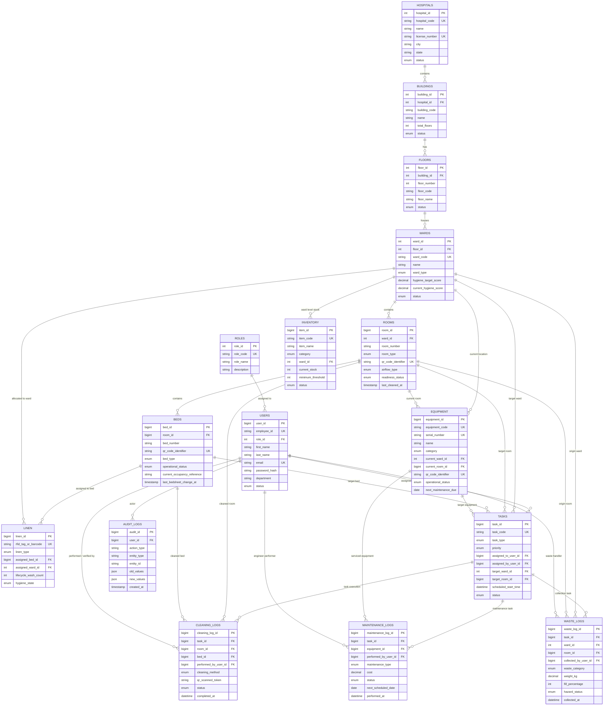

# Smart Hospital Hygiene & Resource Intelligence Platform
## Relational Database Architecture & Entity Relationship (ER) Documentation

This document describes the 3NF-normalized relational database architecture for the **Smart Hospital Hygiene & Resource Intelligence Platform**, implemented for **MySQL 8.0+** using the `InnoDB` storage engine.

---

## 📊 Entity Relationship (ER) Diagram



---

## 🏛️ Schema Entity Dictionary & Structural Details

### 1. Security & Identity Management
| Table | Description | Primary Key | Key Foreign Keys | Purpose |
| :--- | :--- | :--- | :--- | :--- |
| `roles` | System authorization categories | `role_id` (INT) | None | RBAC (ADMIN, CLEANING_STAFF, AUDITOR, etc.) |
| `users` | Hospital staff directory | `user_id` (BIGINT) | `role_id` -> `roles` | Staff authentication, task assignment, and audit tracking |

### 2. Spatial Infrastructure Hierarchy (Facility -> Ward -> Bed)
| Table | Description | Primary Key | Key Foreign Keys | Purpose |
| :--- | :--- | :--- | :--- | :--- |
| `hospitals` | Top-level healthcare facility | `hospital_id` (INT) | None | Multi-campus enterprise support |
| `buildings` | Block/Tower within hospital | `building_id` (INT) | `hospital_id` -> `hospitals` | Physical campus organization |
| `floors` | Vertical elevation levels | `floor_id` (INT) | `building_id` -> `buildings` | Spatial layout and navigation |
| `wards` | Specialized care zones | `ward_id` (INT) | `floor_id` -> `floors` | Ward hygiene target scoring & grouping |
| `rooms` | Enclosed rooms & OT chambers | `room_id` (BIGINT) | `ward_id` -> `wards` | QR code scanning, airflow barrier & readiness |
| `beds` | Physical bed and incubator frames | `bed_id` (BIGINT) | `room_id` -> `rooms` | QR code identification, linen assignment, status |

### 3. Resource & Asset Intelligence
| Table | Description | Primary Key | Key Foreign Keys | Purpose |
| :--- | :--- | :--- | :--- | :--- |
| `linen` | Reusable hospital textiles | `linen_id` (BIGINT) | `assigned_bed_id`, `assigned_ward_id` | RFID laundry cycle and wash count tracking |
| `equipment` | Biomedical & disinfection devices | `equipment_id` (BIGINT) | `current_ward_id`, `current_room_id` | Ventilator/UV-C maintenance and calibration tracking |
| `inventory` | Consumables & PPE supplies | `item_id` (BIGINT) | `ward_id` -> `wards` | Automated low-stock alerts & depot replenishment |

### 4. Operations, Maintenance & Hazardous Waste
| Table | Description | Primary Key | Key Foreign Keys | Purpose |
| :--- | :--- | :--- | :--- | :--- |
| `tasks` | Operational hygiene dispatching | `task_id` (BIGINT) | `assigned_to_user_id`, `assigned_by_user_id`, `target_ward_id`, `target_room_id`, `target_bed_id`, `target_equipment_id` | Task life-cycle: PENDING -> IN_PROGRESS -> COMPLETED |
| `cleaning_logs` | Sanitization execution records | `cleaning_log_id` (BIGINT) | `task_id`, `room_id`, `bed_id`, `performed_by_user_id`, `verified_by_user_id` | Physical QR scan verification and cleaning audit |
| `maintenance_logs` | Biomedical servicing records | `maintenance_log_id` (BIGINT) | `task_id`, `equipment_id`, `performed_by_user_id` | HEPA filter replacement, calibration and repair costs |
| `waste_logs` | Biomedical hazardous waste logs | `waste_log_id` (BIGINT) | `task_id`, `ward_id`, `room_id`, `collected_by_user_id` | Color-coded category, container RFID, weight, and CBWTF transfer |
| `audit_logs` | Regulatory audit log | `audit_id` (BIGINT) | `user_id` -> `users` | Immutable tracking of Who, What, Where, When, and JSON state diffs |

---

## 🔒 Zero Patient-PII Design Principle

In accordance with healthcare data protection standards (such as HIPAA and regional health privacy mandates), **the database stores zero patient-sensitive identifying information** (no names, dates of birth, medical histories, or diagnoses).

- **Bed Occupancy**: Tracked via anonymous operational references (`current_occupancy_reference`, e.g., encounter tracking ID `ENC-20261018-8472`).
- **Clinical Readiness**: Focuses entirely on whether rooms and beds are mechanically, biologically, and operationally **Clean, Sterilized, and Ready for Use**.

---

## ⚡ Indexing & Performance Strategy

1. **Composite Unique Keys**:
   - `buildings`: `(hospital_id, building_code)` prevents duplicate block codes per campus.
   - `floors`: `(building_id, floor_number)` guarantees unique floor numbering per building.
   - `rooms`: `(ward_id, room_number)` ensures unique room numbering per ward.
   - `beds`: `(room_id, bed_number)` ensures unique bed numbering per room.
2. **QR & RFID Lookups**:
   - Unique B-Tree indexes on `rooms.qr_code_identifier`, `beds.qr_code_identifier`, `equipment.qr_code_identifier`, and `linen.rfid_tag_or_barcode` provide **$O(1)$** lookup times during mobile scanning.
3. **Foreign Key Indexing**:
   - All foreign keys are explicitly indexed to guarantee optimal `JOIN` execution and prevent full-table locks during cascading updates.
4. **Temporal & Filtering Queries**:
   - Indexes on `tasks.scheduled_start_time`, `cleaning_logs.completed_at`, `waste_logs.collected_at`, and `audit_logs.created_at` ensure sub-millisecond filtering across date ranges.

---

## 🛠️ Verification in MySQL

To create and verify this schema in your MySQL instance:

```bash
# Log in to MySQL and execute schema.sql
mysql -u root -p < database/schema.sql
```

Or within the MySQL interactive prompt:
```sql
SOURCE database/schema.sql;
SHOW TABLES;
```
